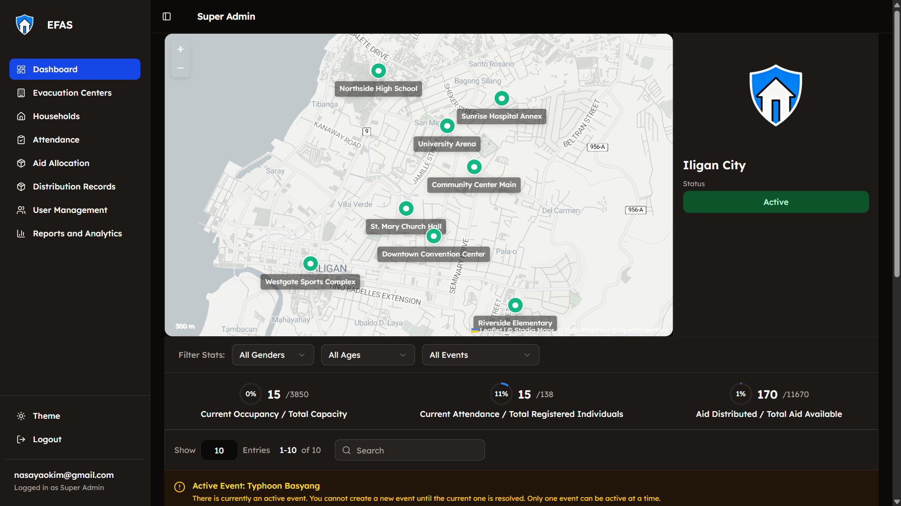
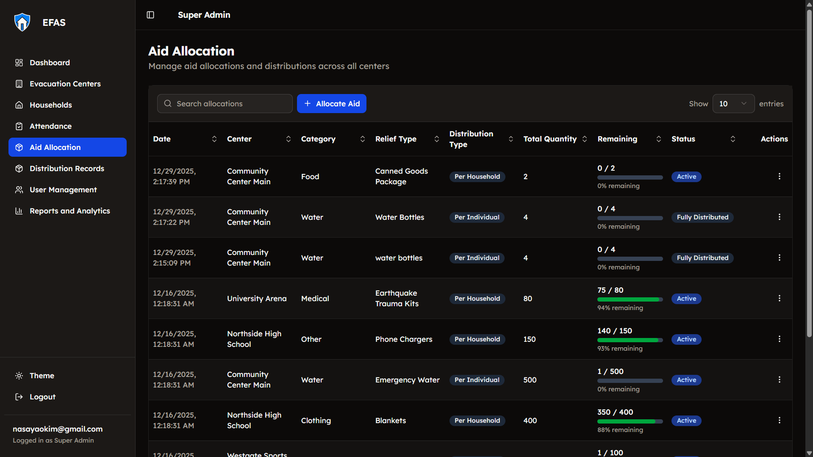

# EFAS: Evacuation Facility Administration System

A web-based disaster management platform that enables local government units to coordinate evacuation centers, track households and attendance, and manage aid distribution during emergency events.

---

### Evacuation Facility Management

### Resource Allocation

---

## Features

* **Evacuation Center Management** – Create, update, and monitor multiple evacuation centers across a city with centralized oversight.
* **Role-Based Access Control (RBAC)** – Secure multi-user workflows for City Admins, Center Admins, and Volunteers using JWT authentication.
* **Household Registration & Attendance Tracking** – Register households and track real-time attendance during disaster events for accurate occupancy monitoring.
* **Aid Allocation & Distribution** – Allocate resources to evacuation centers and track distribution to households with full visibility and accountability.
* **Real-Time Dashboards & Analytics** – Monitor occupancy, resource usage, and event statistics through centralized dashboards for data-driven decision-making.
---

## Technologies Used

* Flask
* PostgreSQL
* React
* Docker
* Stadia Maps

## Backend startup

Set `DATABASE_URL` to an explicit PostgreSQL database for both entry points.
Use a `postgresql://` or `postgresql+psycopg2://` URL with a database name.
From `backend`, use `pipenv run dev` for local development. The production
`pipenv run start` command loads `wsgi:app` and also requires `SECRET_KEY` and
`JWT_SECRET_KEY` from the deployment environment. Generate separate, strong
random values, store them in your deployment's secret manager, and use the
same values across workers and restarts. Missing, blank, or known development
keys abort startup before the app is initialized. Production debug mode is
disabled. Changing the JWT signing key invalidates tokens signed with the
previous key.

For a fresh PostgreSQL database, set `DATABASE_URL` and run
`pipenv run flask --app app db upgrade` from `backend`. The first migration
refuses an existing EFAS schema. Follow the [migration and recovery plan](docs/overhaul/MASTER_PLAN.md#database-002a--version-the-existing-postgresql-schema)
before adopting a legacy database.

